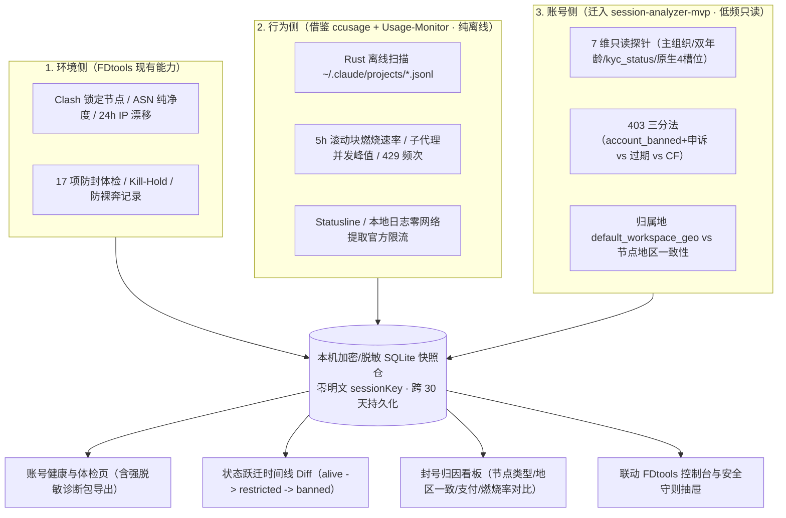

# GitHub 成熟 Claude 监测项目深度借鉴与并入 FDtools 规划

> **状态**：待评审（方案研究与选型定稿）  
> **适用项目**：`FD Claude 安全启动器（FDtools）`（Tauri v2 Rust + React 19 + TypeScript + Tailwind v4）  
> **前置实证**：基于 `ssessionkeytester` 逆向分析、6 个 GitHub 成熟开源项目调研，以及 `session-analyzer-mvp` 真实账号实测（含正常 Free+KYC 已验多组织样本与 `account_banned` 官方封号实锤样本）。

---

## 一、核心结论：为什么要融合，以及绝不照搬什么？

GitHub 开源生态与我们实测的账号探测 MVP 恰好处于**完全互补的两端**：
- **GitHub 成熟项目强项**：纯离线解析本机 `.jsonl` 日志（零网络请求、不触发风控）、5 小时/7 天滚动窗口燃烧速率预测、官方 `statusline` 零额外探测捕获、Rust 原生轻量轮询与 SQLite 长期历史仓储。
- **我们已验证的 MVP 强项**：账号侧精准风控诊断（多组织智能识别、双年龄、`kyc_status`、原生 4 大风控槽位、`account_banned` 封号与可申诉判定、以及 **`default_workspace_geo` 归属地 vs 当前代理出口 `cf-ray` 一致性校验**）。
- **`FDtools` 现有强项**：Windows 11 防封硬门禁（Clash TUN/Fake-IP/固定节点、IPv6 禁用、Kill-Hold 押运锁、防裸奔拦截、双平台节点纯净度评分、日志异常监控与安全守则联动）。

**并入红线（明确舍弃项）**：
1. **绝不并入任何写操作/破坏性能力**：不集成会话吊销（`/api/revoke`）或批量刷 KYC 链接（`/api/refresh-kyc`），坚守 `FDtools` 只读诊断与安全护航定位。
2. **绝不高频暴力轮询 Claude 内部接口**：杜绝“观测者效应”（检测行为本身触发风控），优先使用**纯离线日志解析**与**用户手动触发/低频采样**。
3. **绝不破坏现有 UI 红线**：严格遵守 [`docs/ui-design-system.md`](./ui-design-system.md)（不污染悬浮窗 HUD 三维微卡 2 行结构、坚持静默正常高亮异常与一屏唯一主蓝色 CTA）。

---

## 二、GitHub 成熟项目逐项拆解与借鉴矩阵（用量与状态监控类）

| 项目 / 来源 | 技术栈 | 核心强项 | 推荐借鉴的观点 / 思路 / 代码机制 | 是否建议并入 `FDtools` |
| :--- | :--- | :--- | :--- | :---: |
| **[Maciek-roboblog/Claude-Code-Usage-Monitor](https://github.com/Maciek-roboblog/Claude-Code-Usage-Monitor)** | Python (`Rich`) | Usage-Ops、官方 statusline、本地历史仓 | 1. **数据可信度溯源标签**（`official` / `local_estimate` / `unknown`） 2. **Statusline 零额外请求捕获**官方限流数据 3. **本地长期仓库**突破官方 30 天日志滚动清理限制 4. 5h 窗口燃烧速率预警 | **强烈推荐（核心思路）** |
| **[ryoppippi/ccusage](https://github.com/ryoppippi/ccusage)** | **Rust 核心** + TS | 极速离线 `.jsonl` 日志解析、5h 块与子代理统计 | 1. **Rust 纯离线扫描 `~/.claude/projects/*.jsonl`**，零网络请求即可还原真实调用强度与突发脉冲 2. **Subagent / Sidechain 真实消耗统计**，识别隐形高并发调用 3. 5 小时滚动块（`blocks`）建模 | **强烈推荐（代码架构最契合 `src-tauri`）** |
| **[CodeZeno/Claude-Code-Usage-Monitor](https://github.com/CodeZeno/Claude-Code-Usage-Monitor)** | **Rust** | Windows 任务栏轻量化双进度条监控 | 1. 读取本机 `~/.claude/.credentials.json` 凭据机制 2. 低频被动轮询（与 `FDtools` 现有 15 分钟巡检同频） 3. 5h / 7d 双进度条极简视觉呈现 | **推荐（凭据发现与低频策略）** |
| **[cn0xroot/CC-Monitor](https://github.com/cn0xroot/CC-Monitor)** | Python + SQLite + Web UI | 行为审计、Claude Code Hooks、SQLite 账本 | 1. **本地 SQLite 统一审计账本**设计 2. 零遥测、零重依赖原则 3. 只读读取 `~/.claude.json` 账号画像 | **部分借鉴（只借 SQLite 账本与画像读取，不借命令拦截与 Linux eBPF）** |
| **[LyndonWangWork/Claude-Code-Usage-Tracker](https://github.com/LyndonWangWork/Claude-Code-Usage-Tracker)** | **Tauri + React + Rust** | 桌面端用量趋势可视化 | Tauri 前后端 IPC 数据聚合与趋势图表组织方式（技术栈与 `FDtools` 100% 同构） | **参考（IPC 与图表结构）** |
| **`session-analyzer-mvp`（本项目已验证）** | Node ESM + Web UI | 7 维账号风控体检、脱敏导出、`geo` 比对 | 1. 多组织智能选主（跳过 Console `api_individual`，锁定 `chat` 主组织） 2. **HTTP 403 三分法**（`account_banned` 实锤封号 + 可否申诉 vs 凭据过期 vs CF 弹盾） 3. **`default_workspace_geo` vs 出口边缘 `cf-ray` 地区一致性校验** 4. 零明文落盘（仅存 SHA-256 指纹 + 脱敏邮箱）与一键强脱敏诊断包 | **核心主体（直接迁入 `src-tauri` + `src/`）** |

---

## 二（续）、GitHub 长尾 / 小众「Claude 账户与本机安全审计」高价值项目挖掘

> 相比高星用量看板，以下小众 / 垂直安全审计项目直接切中 **凭据卫生、配置防篡改、无 key 浏览器态采集与组织合规审计**，对 `FDtools` 的“安全护航”定位有极强补位价值。

| 项目 / 思路来源 | 定位类型 | 核心亮点与安全洞察 | 对 `FDtools` 的具体借鉴价值 |
| :--- | :--- | :--- | :--- |
| **Manifest V3 本地扩展无 Key 体检思路**（GitHub 社区 Chrome 扩展实践） | 浏览器侧账户/KYC 审计 | 不要求用户手动复制 `sessionKey`，直接在已登录的 `claude.ai` 标签页内用 `fetch(..., { credentials: "include" })` 查 `/api/organizations` 与 `/kyc_status` | **极高**：100% 复用真实浏览器 TLS 指纹与 Cookie，彻底规避剪贴板泄密与 Cloudflare 弹盾；可作为 `FDtools` 未来“Tauri WebView / 浏览器伴侣扩展”的免抠 key 备选通道 |
| **`tdccccc/claude-security-audit` & `claudit-sec`** | 本机配置与 MCP 审计 | 扫描 `~/.claude/settings.json`、`.claude/settings.local.json`、`skills/`、`plugins/` 与 MCP 配置，揪出**恶意 Hook 注入**、过宽放行规则（如 `Bash(docker run *)`）以及**权限白名单里的明文凭据泄漏（Secret Sprawl）** | **高**：`FDtools` 已有「Claude 本机卫生」模块，只需低成本增加一项只读体检——扫描本机 `settings*.json` 的 `allow` 列表是否意外明文固化了 `Bearer` / `sk-ant-` / 密码或未知异常 Hook |
| **`ashishmerani/claude-code-security-harness`** | 配置防篡改与供应链护栏 | 重点防护本地 Hook/安全配置被外部程序或更新器静默篡改，并对安装行为做风险校验 | **高**：可借鉴其**配置完整性哈希校验**思路，守护 `FDtools` 写入的 `~/.claude/settings.json` 降噪配置与 Clash 覆写规则不被静默覆盖 |
| **`danielhagever/agent-guardrails-kit`** | Fail-Closed Hook 护栏与 JSON 审计 | 提供默认拒绝（Fail-Closed）的 `PreToolUse` 策略与结构化 JSON 审计日志，拦截高危命令与敏感路径读写 | **中**：可在「环境维护 / 安全守则」中作为进阶本地护栏参考，与 `FDtools` 现有的防裸奔/熔断理念一致 |
| **[anthropics/axt-verify](https://github.com/anthropics/axt-verify)** & **Compliance API 生态**（如 `claude-compliance-sdk`、`anthropic_compliance_app_for_splunk`） | 官方组织级合规与透明日志审计 | `axt-verify`（Go）基于 C2SP `tlog` 在本地独立密码学校验 Anthropic Access Transparency 日志；Compliance API 消费组织级配置修改、API Key 创建与会话审计事件 | **中（远期 Team/Enterprise 路线）**：若未来 `FDtools` 拓展团队/企业版，这是 100% 官方合规、零风控摩擦的正统审计接口 |
| **本地遥测与 `tool_input` 隐私清洗审计**（OpenTelemetry 安全研究） | 隐私与凭据防外泄 | 指出 CLI 遥测与本地日志可能意外记录带明文 Token 的命令行参数 | **高**：强化 `FDtools` 现有第 10 项「隐私降噪 & 遥测缓存」，增加对本机 `.claude/` 敏感凭据残留的只读体检与提醒 |

---

## 三、深度融合架构：打通「环境 × 行为 × 账号」三方封号归因闭环

将上述成熟思路与 `FDtools` 现有模块融合后，系统将具备市面上开源项目和在线测活站均不具备的**三维联合归因能力**：

---

## 四、高价值融合亮点（最值得优先落地的功能）

### 1. 「账号归属区 vs 锁定节点地区」自动一致性门禁（独家核心壁垒）
- **实测依据**：实测样本中账号 `default_workspace_geo` 为 `us`，而出口 `cf-ray` 落在了 `SYD`（悉尼）。
- **融合方式**：在 `FDtools` 控制台现有「出口节点合规」或「单号卫生锁」中，当用户完成一次账号体检后，自动缓存该主号的 `workspaceGeo`（仅存地区码如 `us`，不存明文 key），并与 Mihomo 当前锁定节点的出口国家做自动比对；一旦跨区不一致即标黄预警，并与「安全守则」联动。

### 2. 离线行为强度归因（借鉴 `ccusage` + `Claude-Code-Usage-Monitor`）
- **为什么必须做离线**：用网络轮询去盯用量既慢又增加风控面；直接用 Rust 离线解析本机 `~/.claude/projects/*.jsonl`（纯本地磁盘读取，毫秒级完成），即可得到：
  - 近 5 小时 / 7 天本地真实 Token 消耗与子代理并发倍数；
  - 每次突发高频调用的时间点；
  - 结合「数据溯源标签」（`official` 官方 `/usage` vs `local_estimate` 本地日志估算），让用户清晰知道数据来源与可信度。

### 3. 精准 403 三分法与「实锤封号 → 自动联动本机卫生清理」
- **实测依据**：实测封号样本明确返回 `error.details.error_code = "account_banned"` 且携带 `appeals_redirect_enabled: true`。
- **融合方式**：
  - 区分 **实锤封号（`account_banned`）**、**普通会话过期**、**Cloudflare 弹盾**；
  - 一旦探测出当前本机绑定主号出现 `account_banned`，立即提示是否支持官方申诉，并可直接一键跳转到 `FDtools` 现有的 **「环境维护 → 备份并纯净清理污染目录」**，防止已封账号残留污染下一个新号（彻底打通防连坐闭环！）。

### 4. 统一脱敏本地仓库与「导出增强版 AI 诊断包」
- 沿用 `session-analyzer-mvp` 的隐私红线：**永不落盘明文 `sessionKey`**（仅存 SHA-256 不可逆指纹 + 掩码 + 脱敏邮箱）；
- 将账号体检的**强脱敏结构报告**直接并入 `FDtools` 现有的「导出脱敏诊断包给 AI 分析」ZIP 中，排障时一次提供环境 + 日志 + 账号脱敏画像。

---

## 五、分期并入实施路线图（待确认）

> 说明：以下按工程风险由低到高、收益由大到小分为 3 个阶段，待你确认范围后再逐期排入开发与视觉 QA 门禁。

### Phase 1（P0 · 最小侵入高价值并入）：账号体检核心迁入 Rust + 独立分析抽屉/子页
- [ ] **P0-1**：将 `session-analyzer-mvp` 的核心只读探测、多组织选主、`kyc_status`、403 三分法（含 `account_banned` + 申诉状态）与 `geo` vs `cf-ray` 比对逻辑，移植为 `src-tauri/src/account_probe/` Rust 模块（复用 Mihomo 代理配置与现有 HTTP 客户端，遵守只读红线）。
- [ ] **P0-2**：落地零明文本地脱敏存储（复刻指纹归档 + 时间线 Diff + 环境归因标签），仅保存在用户本机 AppData 私有目录。
- [ ] **P0-3**：按 `docs/ui-design-system.md` 设计高保真原型（复用现有 HeroUI / Design Tokens，先出交互原型验收），提供「账号体检 / 时间线 / 强脱敏诊断包导出」入口。
- [ ] **P0-4**：联动现有防封体系：检测到 `geo` 地区不匹配时触发预警；检测到 `account_banned` 时提供申诉提示与「前往环境维护清理防连坐」直达按钮。

### Phase 2（P1 · 零网络行为归因）：借鉴 `ccusage` & `Usage-Monitor` 接入离线行为分析
- [ ] **P1-1**：在 Rust 后端新增纯离线 `~/.claude/projects/*.jsonl` 增量解析器（带文件 mtime 缓存，不扫描聊天正文内容，仅统计时间分布、模型、Token 规模与子代理并发数）。
- [ ] **P1-2**：引入「数据溯源标签」（`官方实测` / `本地估算` / `未知`）与 5 小时滚动块燃烧速率预警，接入「日志分析」与「安全守则」联动。
- [ ] **P1-3**：支持选配读取本机 `~/.claude/.credentials.json` 账号元数据（只读、用户显式授权开关），并评估提供轻量 Manifest V3 伴侣扩展 / Tauri WebView 免抠 `sessionKey` 采集路径。
- [ ] **P1-4**：在「Claude 本机卫生」新增只读配置安全审计（借鉴 `claude-security-audit` & `claude-code-security-harness`）：检测 `settings*.json` 权限白名单明文凭据泄漏（Secret Sprawl）、未知异常 Hook 注入、以及降噪/规则配置完整性防篡改校验。

### Phase 3（P2 · 长期封号归因闭环）：统一 SQLite 仓库与归因看板
- [ ] **P2-1**：借鉴 `CC-Monitor` 与 `Usage-Monitor` 的本地 Warehouse 思路，将「节点漂移历史 + 日志 429/异常 + 离线调用强度 + 账号状态跃迁快照」统一沉淀到本机 SQLite 仓库（突破 30 天日志限制）。
- [ ] **P2-2**：上线「风控与封号归因看板」，横向统计不同节点类型（ISP 住宅 vs 机房）、地区一致性、支付渠道、账号年龄与燃烧速率下的受限率与存活周期。
- [ ] **P2-3**：将账号强脱敏画像合并写入 `FDtools` 现有的「导出脱敏排障 ZIP 包」。

---

## 六、开源合规与安全提醒
- 上述 GitHub 项目均用于**架构思路、解析规范与工程实践借鉴**；如后续直接复用任何第三方仓库代码片段或 crate，需逐项核验其开源协议（如 MIT / Apache-2.0）并在项目中保留对应声明。
- `FDtools` 面向终端用户发布商业/分发版本时，账号探测功能须默认处于**用户主动触发（On-Demand）**模式，切勿在后台静默高频请求 `claude.ai` 内部接口，确保绝对不成为触发风控的诱因。
