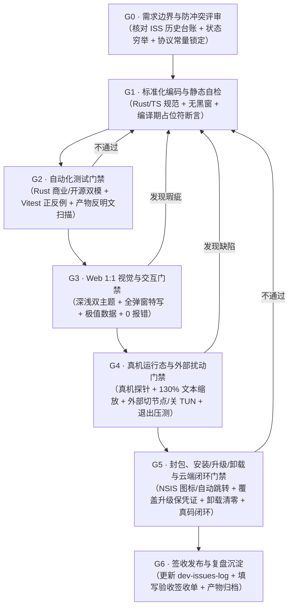

# FD Claude 安全启动器 · 开发、测试与验收全生命周期标准流程（SOP）

> **文档编号**：`FD-STD-000`  
> **当前版本**：`v2.0`（沉淀自项目真机实战缺陷库 `ISS-001 ~ ISS-040`）  
> **适用对象**：人类开发者、测试/QA 人员、以及参与本项目开发与审图的 AI 智能体。  
> **配套分册**：
> - 开发规范：[`docs/standards/development-standard.md`](./development-standard.md)
> - 测试规范：[`docs/standards/testing-standard.md`](./testing-standard.md)
> - 验收规范与签收表：[`docs/standards/acceptance-checklist.md`](./acceptance-checklist.md)
> - UI 设计与视觉门禁：[`docs/ui-design-system.md`](../ui-design-system.md)
> - 缺陷与决策追踪台账：[`docs/dev-issues-log.md`](../dev-issues-log.md)

---

## 1. 制定背景与核心目标

项目前期在快速迭代过程中，尽管单测与浏览器预览均通过，但进入真机环境后仍暴露了大量高影响缺陷（详见 `ISS-005 ~ ISS-040`），根因高度集中在 **5 大系统性盲区**：

1. **只测快乐路径，漏测失败态与反例**：激活失败报错被 `useEffect` 瞬间清空（`ISS-027`）、修复失败误报成功（`ISS-039`）、正则误杀「澳大利亚」与 PID `14292`（`ISS-006`/`ISS-019`）。
2. **只验 Web 预览，漏验真实打包 EXE 与 OS 原生行为**：Windows 130% 文本缩放裁切悬浮窗（`ISS-028`）、退出卡死 6~11 秒与双开进程（`ISS-029`）、子进程闪黑窗（`ISS-031`）、Named Pipe 并发报错 `231`（`ISS-005`）。
3. **只验单次运行，漏验安装 / 覆盖升级 / 卸载全生命周期**：NSIS 卸载进度条卡死、覆盖升级误删用户已激活凭证、安装包图标未替换与完成后不自动跳转（`ISS-030`/`ISS-038`）。
4. **只验本地静态，漏验云端真实配置与外部环境扰动**：构建配置残留占位符 URL（`ISS-026`）、线上 Worker Secrets 含隐形换行符导致真码 409（`ISS-032`）、外部手动关 TUN 或切偏节点后控制台无感知（`ISS-039`/`ISS-040`）。
5. **只验空数据与单一权限态，漏验极限数据与商业双态**：备份过多排版挤压（`ISS-017`）、未激活态隐藏项/副页面泄密（`ISS-033`）、未测节点伪造绿标（`ISS-034`）。

本 SOP 的唯一目标：**用不可跳过的硬性门禁（Gate `G0–G6`）替代“口头感觉差不多”，确保任何改动在交付给用户前已经历标准化、可复现、可审计的全链路验证。**

---

## 2. 全生命周期标准流程图（G0 → G6）

---

## 3. 七道强制门禁职责与准出标准（Gate Matrix）

| 门禁 | 阶段名称 | 负责人 / 角色 | 强制执行动作 | 硬性准出标准（缺失任意一条即退回） |
| :---: | :--- | :--- | :--- | :--- |
| **`G0`** | 需求与防冲突评审 | 设计 / 主程 | 阅读最新设计文档、`protocol-constants.md` 与 `dev-issues-log.md` 历史红线；列出全部状态矩阵（正常/失败/加载/空态/极值/未激活/已激活/深浅主题） | 明确修改对象边界、确认不破坏任何历史 `ISS-*` 修复、无歧义大白话文案 |
| **`G1`** | 标准化开发实现 | 开发（Rust / TS） | 严格遵循 [`development-standard.md`](./development-standard.md) 编码；新增或修改的常量/配置/NSIS 脚本同步自检 | `cargo check`（双 Feature）与 `tsc --noEmit` 0 错误 0 警告；编译期占位符断言通过 |
| **`G2`** | 自动化测试门禁 | 开发 / 测试 | 执行 [`testing-standard.md`](./testing-standard.md) 中的 L1–L3 测试；新增功能与修 Bug 必须补齐**正向 + 失败态 + 反例防误报**回归单测 | `cargo test` 商业/开源双模全绿、`npm test` 全绿、`vite build` 0 sourcemap、二进制明文扫描为 `False` |
| **`G3`** | Web 视觉与交互门禁 | QA / 前端 | 启动 `vite preview`，按 [`ui-design-system.md`](../ui-design-system.md) 与 [`acceptance-checklist.md`](./acceptance-checklist.md) 关卡 A 逐图审阅 1:1 局部特写与全弹窗 | 深浅双主题零瑕疵、无按钮折行/表格挤压、HUD 坐标零偏移、全程 `console.error === 0` |
| **`G4`** | 真机运行态与扰动门禁 | QA / 开发 | 安装或运行真实 Release EXE，按关卡 B/C 验证真实系统环境、高 DPI + 130% 文本缩放、外部切节点/关 TUN、封号日志写入、单实例防双开与退出速度 | 17 项探针全真测无假绿标、悬浮窗 130% 文本缩放零裁切、退出 `< 1s` 零残留、内存 `< 50MB` |
| **`G5`** | 安装/升级/卸载与云端闭环 | 发布 / QA | 按关卡 D 验证 NSIS 安装包图标/中文向导/自动跳转、覆盖升级保留授权凭证、彻底卸载无卡顿且清空防火墙/任务/凭证、以及云端 Workers 真码核销与 409 重放拦截 | 安装/升级/卸载 100% 无报错、真码全链路闭环通过、无占位符或脏 Secret |
| **`G6`** | 签收归档与缺陷反哺 | 主程 / 用户终验 | 更新 `docs/dev-issues-log.md`；填写发版验收签收表；任何新暴露缺陷必须反哺到单测与本规范检查项 | 签收表全项打勾、可执行安装包路径与校验结果清晰交付 |

---

## 4. 一票否决红线（Blocker Rules）

出现以下任一情况，**直接判定本次交付不通过，禁止合并或发版**：

1. **诚实性红线**：存在任何伪造绿灯（未实测默认标 `✓`）、修复失败却弹成功提示、或篡改/删除用户 Claude 原始日志与系统开机启动项的行为。
2. **安全与隐私红线**：脱敏诊断包或运行日志泄露明文邮箱/Token/SessionKey/完整公网 IP；商业版 Release 二进制中可搜到明文覆写脚本或明文操作指南；`.local-private/` 下密钥误入 Git；未激活态泄露隐藏检测项真实名称或副页面数据。
3. **可用性灾难红线**：NSIS 卸载卡死或残留防火墙规则导致用户断网自锁；覆盖升级误毁已激活用户的 `vault.dat`/`inst.id`；退出耗时超过 `2s` 或主窗关闭后双开残留进程；生产构建仍指向占位符 API 域名。
4. **视觉与几何红线**：高 DPI 或 Windows 130% 文本缩放下悬浮窗/主窗关键按钮被裁切；存在 `console.error` / `pageerror`；存在开发内部批注文案（如“已按要求优化”“同步自文档”）。
5. **回归退化红线**：任何改动导致 `ISS-001 ~ ISS-040` 中已修复的历史问题复发。

---

## 5. 缺陷闭环与“防复发”铁律（Issue Lifecycle）

项目严禁“修完就算了”。任何测试、自审或用户真机验收发现的问题，必须完整走完以下 **4 步闭环**：

1. **登记台账**：在 [`docs/dev-issues-log.md`](../dev-issues-log.md) 追加递增编号 `ISS-XXX`，写清：**发现阶段、复现条件与真机现象、根本原因、修复方案、实测证据**。
2. **根因修复**：禁止只打表面补丁（例如只隐藏现象不修状态机、只改前端不改后端门禁）。
3. **补自动化回归单测**：能写成 Rust 或 Vitest 断言的，必须新增回归用例（例如 `ISS-006` 澳大利亚正则单测、`ISS-019` PID `14292` 防误报单测、`ISS-027` 失败提示持久展示单测）。
4. **反哺标准清单**：若该缺陷属于流程或验收盲区（如 `ISS-028` 文本缩放、`ISS-030` 覆盖升级保护、`ISS-032` Secret 换行符），必须同步补充到 `docs/standards/` 对应规范的检查清单中。

---

## 6. 历史缺陷（ISS-001 ~ ISS-040）到标准门禁的映射总表

| 缺陷类别 | 典型历史案例 | 曾遗漏原因 | 现已固化的拦截门禁 |
| :--- | :--- | :--- | :--- |
| **配置/密钥低级错误** | `ISS-026` 占位符域名、`ISS-032` Secret 尾随换行符 | 缺少编译期硬断言与上线前真码闭环 | `G1` `build.rs` 占位符 `assert!` + `G5` 云端真码实测闭环 |
| **失败路径与假成功** | `ISS-009` 误显绿字、`ISS-027` 报错闪没、`ISS-039` 修复假成功 | 单测与手测仅覆盖成功路径 | `G2` 失败路径强制单测 + `G4` 真机失败态手测 |
| **正则与边界误报** | `ISS-006` 误杀澳大利亚、`ISS-007` 重复脱敏、`ISS-019` 误报 PID `14292` | 未写反例测试集 | `G2` 反例/边界单测强制项 |
| **Windows 原生特性坑** | `ISS-005` 管道忙 `231`、`ISS-012` 拉 `tasklist`、`ISS-029` 退出卡顿双开、`ISS-031` 闪黑窗 | 仅在浏览器预览验收，未测真机 EXE 性能与窗口行为 | `G1` Win32 编码红线 + `G4` 真机运行态与退出压测 |
| **高 DPI 与文本缩放裁切** | `ISS-010` 底部留白、`ISS-018` 高 DPI 裁切、`ISS-028` 130% 文本缩放裁切 | 未在 Windows `TextScaleFactor > 100%` 环境实测 | `G1` 双因子缩放公式 + `G4` 130% 文本缩放必测项 |
| **外部环境漂移与状态同步** | `ISS-020` 封号日志未自动刷新、`ISS-039`/`ISS-040` 外部关 TUN/切偏节点无感知 | 仅测软件内点击，未测外部软件并发改状态 | `G4` 外部扰动 E2E 测试（`live_e2e_edge_cases_audit`） |
| **NSIS 安装/升级/卸载坑** | `ISS-030` 卸载卡死与升级删凭证、`ISS-038` 安装包图标与自动跳转 | 只验 `tauri build` 生成 EXE，未真实安装/升级/卸载 | `G5` NSIS 安装 → 覆盖升级 → 彻底卸载全流程实测 |
| **商业授权与隐私双层边界** | `ISS-033` 未激活泄露隐藏项与副页、`ISS-034` 假绿标 | 仅在前端隐藏按钮，未验未激活态前后端脱敏与零假标 | `G2` 商业双态与明文扫描 + `G4` 未激活态逐页审查 |
| **极限数据与视觉细节** | `ISS-017` 多备份挤压、`ISS-021` 缺加载态与运行态 CTA、`ISS-037` 表格拥挤 | 预览样本条数过少、未看 1:1 局部特写 | `G3` 极值数据 + 全弹窗 1:1 特写审图 |
