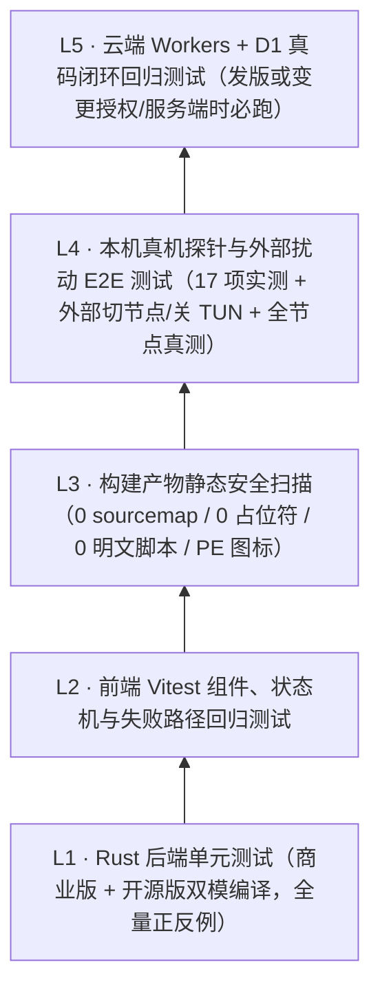

# FD Claude 安全启动器 · 测试阶段标准化规范（Testing Standard）

> **文档编号**：`FD-STD-002`  
> **所属总纲**：[`docs/standards/engineering-lifecycle-sop.md`](./engineering-lifecycle-sop.md)（对应门禁 `G2` 与 `G4/G5` 自动化测试部分）  
> **核心理念**：**测试不是只测“能跑通”，测试的核心职责是证明“失败时清晰报错、边界时不误报、外部扰动时能自愈、打包后无泄密”。**

---

## 1. 五层测试金字塔（Testing Pyramid）

所有迭代交付或发版前，必须自下而上依次通过以下 **5 层测试**，禁止跳过中间层级：



---

## 2. 分层测试规范与强制用例清单

### L1 · Rust 后端单元测试（双 Feature 模式）
- **必跑命令（PowerShell 5.1）**：
  ```powershell
  Set-Location src-tauri
  cargo test --lib
  if ($LASTEXITCODE -eq 0) { cargo test --lib --no-default-features }
  ```
- **通过标准**：商业版与开源版均为 **0 failed、0 compiler warnings**。
- **强制覆盖的 6 类用例（新增模块或修 Bug 必须补齐）**：
  1. **协议常量锁定断言**：`docs/protocol-constants.md` 中错误码、魔数 `0x12708F87`、占位符 `<REDACTED:2W>`、时序 `60489 / 29121 / 904543`、四维权重 `0.37 / 0.25 / 0.24 / 0.14` 100% 精确断言。
  2. **反例与防误报用例（强制！）**：
     - 禁区正则必须显式断言**放行合法易混词**（如 `🇦🇺澳大利亚|原生` 不被「澳」误杀、`US-LA-Static-01` 不被误杀）；
     - 日志解析必须显式断言**不误报近似数字与无关噪音**（如 PID `14292` 不触发 429 限流、`custom3p-setup.log` 未登录 503 / `ERR_NETWORK_IO_SUSPENDED` 合盖休眠 / `sessiondata.vhdx` / `chrome-native-host` 未运行均不计入风控异常）；
     - 日志分层断言：明确区分「确认封禁（`account_banned` / `len=130`）」、「Verification Portal 验证受限（`portal.anthropic.com/verify`）」、「单号 KYC/权限暂限（`len=164` / `len=156`）」、「带 Cookie 脱敏 403（`withheld, 182 chars`）vs 未登录 `credential: none`」；
     - 账号提取正则断言：必须同时覆盖无引号 `orgId=xxx` 与标准 JSON 双引号 `"orgId": "xxx"` / `"accountId": "xxx"`；
     - 进程树筛选必须显式断言**不误杀无关进程**（如挂载在普通 `chrome.exe` 下的 `chrome-native-host.exe` 绝不被误杀）；
     - 运行中热熔断状态机断言：`bg_claude_procs > 0` 时遇 Clash 离线/关 TUN/切 `direct`/禁区节点必触发，`bg_claude_procs == 0` 或核验态必不误触。
  3. **脱敏引擎零泄露与不重复打码用例**：同时包含邮箱、`Bearer`、`sk-ant-*`、`sessionKey`、Windows 用户名路径、公网 IPv4/IPv6 与时间 `HH:MM:SS` / `198.18.x.x` 白名单，断言所有敏感信息被替换且无二次破坏。
  4. **Kill-Hold 状态机与事务锁用例**：启动 45s → 拦截复活顺延 `+15s` → 事务锁期间永不过期 → 释放事务锁衔接倒计时 → 安全启动前优雅清零。
  5. **商业授权密码学与未激活脱敏用例**：Ed25519 真实签发与验签（含篡改签名、换设备指纹、换 `inst.id` 全拒绝）+ AES-256-GCM 错误密钥直接解密失败 + Windows DPAPI `CryptProtectData/UnprotectData` 往返加密 + 未激活态 `sanitize_preflight_report` 彻底剥离隐藏项明文。
  6. **原子事务备份还原用例（含 MSIX）**：唯一时间戳不覆盖、降序排序精确到秒、还原前自动建安全点、坏 ZIP 拒绝覆盖原目录、MSIX `LocalCache\{Roaming,Local}\Claude` 分桶备份/清理/原子还原完整闭环且兼容旧版无 `msix/` 桶 ZIP。

---

### L2 · 前端 Vitest 组件与交互回归测试
- **必跑命令**：
  ```powershell
  npm test
  ```
- **通过标准**：所有测试文件 **100% passed**。
- **强制覆盖的 5 类前端回归用例**：
  1. **失败路径与报错持久性测试（防 `ISS-027` / `ISS-039`）**：
     - Mock `ipc.activateLicense` 抛出错误时，断言错误提示容器在提交结束（`submitting` 回到 `false`）后**依然持久可见**，绝不闪烁消失；
     - Mock `ipc.fixPreflightItem` 返回 `requiresManualStep: true` 或 `success: false` 时，断言不弹出“修复成功”绿吐司。
  2. **商业授权双态对比测试（防 `ISS-009` / `ISS-033`）**：
     - 未激活态：控制台仅展示允许的免费项，隐藏项不泄露真实标题/状态/实测数据/明文指南，4 个副页面被门禁拦截，隐藏底部导出链接，激活弹窗 Footer 左侧绝不含 QQ/售后字样；
     - 已激活态：展示解密清晰指南，且只要 `status !== "ok"`（即使 `fixLabel === null`）始终保留「导出脱敏问题包给 AI 分析」链接；主窗顶栏耳机售后按钮可弹出官方售后 QQ `2568515327`。
  3. **运行态动态切换与加载态测试（防 `ISS-021`）**：
     - `bgClaudeProcs > 0` 时主 CTA 自动变为「安全退出 Claude（N 进程运行中）」；
     - Kill-Hold 激活时侧边栏与 `HudCard` 同步展示蓝色 `盯防 Xs` 与解除按钮。
  4. **高密度表格与筛选联动测试（防 `ISS-022` / `ISS-037`）**：
     - 节点页表头列数、关键徽标、`管道已连接`（不含「已直连」）与禁用态断言；
     - 日志页 4 张统计卡点击筛选、模拟演示徽章与本地遥测预览面板开关断言。
  5. **防回归核心红线测试**：主窗口副标题固定 `Fuck Dario！！！`、顶栏纯图标开关双向同步、同区热备 vs 跨洲切换弹窗判定准确（`JP -> US` 绝不误判为同区）。

---

### L3 · 构建产物与二进制静态安全门禁
每次合并或打包前必须执行以下命令链，**任何一项失败即退回 G1**：

```powershell
# 1. 前端类型检查 + 生产构建
npm run build

# 2. 校验 dist/ 零 sourcemap（防源码裸奔）
$maps = Get-ChildItem -Path dist -Recurse -Filter "*.map"
if ($maps.Count -gt 0) { throw "发现生产 sourcemap 泄露: $($maps.FullName)" }

# 3. 校验 .local-private/ 未被 Git 追踪
$trackedSecrets = git ls-files .local-private
if ($trackedSecrets) { throw "严重安全错误：.local-private 已被 Git 追踪！" }

# 4. 打包后扫描 Release EXE 不含明文覆写脚本（L1 密文驱动实锤）
$bytes = [System.IO.File]::ReadAllBytes("src-tauri\target\release\fd-claude-guard.exe")
$ascii = [System.Text.Encoding]::ASCII.GetString($bytes)
if ($ascii.Contains("function main(config)")) { throw "严重安全错误：Release 二进制包含明文 Script.js！" }
```

---

### L4 · 本机真机探针与外部扰动 E2E 测试
**原则：凡涉及系统注册表、Windows 防火墙、Mihomo 命名管道、真实外网探针、外部软件交互的改动，严禁仅靠 Mock 单测放行，必须在本机真实环境下运行 `--ignored` 真机回归套件！**

- **必跑命令**：
  ```powershell
  Set-Location src-tauri
  # 1. 真机 17 项全量实测探针验收（只读无破坏）
  cargo test --lib live_machine_preflight_audit -- --ignored --nocapture

  # 2. 真机边缘与外部扰动闭环（外部切偏节点识别 + 一键切回 + 节点真测）
  cargo test --lib live_e2e_edge_cases_audit -- --ignored --nocapture
  ```
- **通过标准**：
  1. 所有 11 项必须 + 6 项建议均返回真实探针实测数据（无 `Initializing`、无硬编码假绿灯）；
  2. 全量节点探测完成后「待测」数量为 `0`（除非目标节点真实超时且明确标示 `超时`），耗时在预期预算内（如 16 节点 `< 15s`）；
  3. 外部手动切换 Clash 节点偏离基线后，探针能在 2 秒内识别偏移并给出预警，执行一键切回后恢复绿灯；
  4. **运行中热熔断实机验收（详见 [`docs/optimization-plan-v023.md`](../optimization-plan-v023.md)）**：Claude 运行中直接退出 Clash Verge、切为 `direct` 或关闭 TUN 时，2.5 秒内自动写防火墙规则并强杀进程树归 `0`（`main.log` 末尾无 `onQuitCleanup` 带 Cookie 403）；Claude 为 `0` 进程时执行同操作绝不误熔断；解除熔断后 `netsh` 规则彻底清零。

---

### L5 · 云端 Workers + D1 真码闭环回归测试
**触发条件**：凡修改了 `license-server/`、`src-tauri/src/licensing/`、`src-tauri/build.rs`、`.local-private/build-secrets.json` 或发布正式商用版本前，**必须完整跑通以下 6 步真机云端闭环**：

1. **健康检查**：`GET /api/v1/health` 返回 `HTTP 200 {"ok":true}`；
2. **假码拒绝**：使用随机伪造密钥请求 `POST /api/v1/activate`，断言返回 `HTTP 409`；
3. **测试真码核销**：使用 1 枚专用测试批次真码在线核销，断言 `HTTP 200` 并返回合法 `cert_b64` + `payload_key_hex`；
4. **本地解密与 DPAPI 落盘**：客户端校验 Ed25519 签名通过、AES-256-GCM 成功解密覆写脚本与全部指南、DPAPI 成功写入 `vault.dat`；
5. **纯离线重验**：重启客户端（或实例化新的 `LicenseManager` 不发任何网络请求），断言离线验签 `is_licensed() == true`；
6. **重放防双花**：再次用同一枚已核销测试码请求 `/api/v1/activate`，断言云端 D1 返回 `HTTP 409`（且云端记录 `status = 'used'`）。

---

## 3. 测试编写与提测纪律

1. **一缺陷一回归（Zero-Repeat Rule）**：每解决一个真机或验收 Bug（`ISS-XXX`），若逻辑可自动化覆盖，必须在本次提交中同步新增对应的 Rust 或 Vitest 回归测试并在测试名或注释中标明 `ISS-XXX`。
2. **禁止跳过测试或放宽断言**：严禁为了“让测试通过”而删除/注释已有断言、或者给失败用例加 `skip`；如产品需求确有变更，必须先更新设计文档再同步更新测试断言。
3. **测试环境复原**：真机 E2E 测试如临时切换了节点、写入了测试日志或修改了临时目录，测试结束（含失败分支）必须自动复原用户原有环境，严禁污染本机配置。
