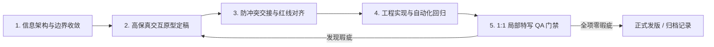

# FD Claude 安全启动器（FD Claude Guard）UI 设计规范与标准化设计验收流程

> **版本**：v2.0（已与 2026-11-24 终版真机代码、17 项探针矩阵、AGY + Claude 6 列节点评估表及未激活全隐藏门禁 100% 同步）  
> **适用范围**：本项目的原型设计、新功能界面扩充、前端组件研发（React 19 + TypeScript + Tailwind v4 + HeroUI + Lucide）以及上线前视觉 QA 门禁。  
> **核心原则**：**克制、静默正常高亮异常、一屏唯一视觉重心、像素级对齐、先基于真实组件/原型定稿后编码、1:1 特写终审。**

---

## 第一部分：标准化 UI 设计与研发协作流程（SOP）

所有新页面、新弹窗或重大交互改动必须严格走完以下 **5 阶段闭环**，禁止跳过原型或只看整屏缩略图直接交付。

### 阶段 1 · 需求与信息架构收敛
1. **对象分界清晰**：所有检测项、设置项与维护动作必须按「修改对象 / 影响范围」严格分组（如：改 Clash 配置 / 改 Windows 系统 / 改 Claude 本机目录），严禁把不同作用对象的修复动作混绑在一起。
2. **状态穷举先行**：设计前先列出该界面的全部边界态——默认空态、正常绿灯态、部分待办态、单步待办态、危急熔断态、未激活体验态、加载态、深/浅双主题。
3. **零开发批注文案**：界面上的所有标题、副标题、提示与徽章必须面向最终用户，严禁出现“已按要求优化”“已并入”“同步自 v1.5 文档”等内部沟通批注。

### 阶段 2 · 高保真可交互原型定稿
1. **单文件实时预览原型**：统一在 [`docs/mockups/interactive-prototype.html`](./mockups/interactive-prototype.html) 中落地真实可点击交互、状态切换、弹窗与动画效果（通过本地静态服务预览，不用静态假图替代交互设计）。
2. **原型自检通过后再交开发**：原型阶段即完成深浅双主题切换、按钮单行防折行、表格零挤压、弹窗联动与 `console.error === 0` 验证，用户确认通过后再同步给开发实现。

### 阶段 3 · 防冲突交接与工程红线对齐
1. **合入前必读问题日志**：向开发交付 UI 变更前，必须核对 [`docs/dev-issues-log.md`](./dev-issues-log.md)，显式标注「合入防冲突红线」，防止照搬静态原型时覆盖已落地的真机工程优化（例如：高 DPI 物理尺寸缩放、动态窗口高度 `ResizeObserver`、Win32 原生进程枚举、`Loader2` 异步加载态、NSIS 既有卸载钩子、非 `ok` 项排障包导出逻辑等）。
2. **单一事实源同步**：设计规范变更同步更新本文档与 [`docs/handoff-to-dev.md`](./handoff-to-dev.md)，避免多份文档口径漂移。

### 阶段 4 · 工程实现与自动化回归
1. **组件令牌化**：颜色、圆角、阴影与动效全部走 CSS Variables / Tailwind Design Tokens，严禁在 TSX 组件内散落硬编码色值（尤其是亮/暗双主题冲突色）。
2. **单测门禁**：前端必须通过 `tsc --noEmit`、`vitest` 与 `vite build` 0 告警；涉及后端联动的状态机与 IPC 必须补齐 Rust 单测。

### 阶段 5 · 强制 1:1 局部放大特写 QA 门禁（核心纪律）
> **铁律：严禁仅凭整屏缩略图或“页面能打开不报错”宣告视觉验收通过！**

1. **全视口与真机交互实测**：在标准桌面视口（≥ `1440×900`）及 Windows 高 DPI 缩放（`100% / 125% / 150%`）下，真实点击所有 Tab、预设场景、所有弹窗（节点切换同区/跨洲、强解熔断、激活密钥、售后支持）、抽屉与悬浮窗交互。
2. **1:1 局部放大裁切肉眼审图**：针对本次改动的关键区域（如顶栏图标组、右侧详情卡与遮罩、模态弹窗、数据表格、侧边栏状态卡、悬浮窗耳标），按实际分辨率比例裁切 **1:1 局部特写图**，逐张肉眼检查是否存在：
   - 按钮文字竖排折行或按钮高度超标（普通按钮须 `≤ 42px`）；
   - 表格列挤压、水平溢出或行高异常撑高；
   - 图标压线、圆点错位、文字截断或孤字掉行；
   - 浅色主题下字色对比度不足或阴影发脏。
3. **几何零偏移实测**：悬浮窗在「固定 ↔ 靠右贴边滑出 ↔ 恢复固定」切换中，实测坐标偏移必须满足 `Δx = 0px, Δy = 0px`；贴边收起态右边缘 `> 20px` 区域必须零误触。
4. **零错误硬指标**：全程浏览器/WebView2 `console.error === 0`、`pageerror === 0`。

---

## 第二部分：视觉基础规范（Design Foundations）

### 2.1 设计基调
- 融合 **HeroUI / Linear / Apple HIG** 的现代桌面端克制美学：深色模式为默认主力视觉（沉稳低眩光、高对比层次），浅色模式为纯净高可读商业白。
- **拒绝花哨装饰**：严禁滥用大面积霓虹渐变、无意义彩色底块或夸张发光；状态颜色仅用于语义传达（安全绿、警告黄、危急红、主行动/盯防蓝）。

### 2.2 色彩系统（Design Tokens）

| Token 变量名 | 深色模式（默认 `[data-theme="dark"]`） | 浅色模式（`[data-theme="light"]`） | 语义用途 |
| :--- | :--- | :--- | :--- |
| `--primary` | `#006fee` | `#006fee` | 品牌主蓝、一屏唯一主 CTA、Kill-Hold 盯防态 |
| `--primary-hover` | `#338ef7` | `#338ef7` | 主按钮悬停态 |
| `--primary-soft` | `rgba(0, 111, 238, 0.14)` | `rgba(0, 111, 238, 0.14)` | 蓝态图标底板、盯防脉冲光晕 |
| `--success` | `#17c964` | `#17c964` | 实测通过、安全在线、0 残留 |
| `--success-soft` | `rgba(23, 201, 100, 0.13)` | `rgba(23, 201, 100, 0.13)` | 绿标徽章底色 |
| `--warning` | `#f5a524` | `#f5a524` | 建议优化风险提示、进程存活、跨洲/送中提醒 |
| `--warning-soft` | `rgba(245, 165, 36, 0.14)` | `rgba(245, 165, 36, 0.14)` | 黄标徽章底色 |
| `--danger` | `#ef4444` | `#dc2626` | 必须项未通过、禁区熔断、CF 403 拉黑 |
| `--danger-bright` | `#f87171` | `#dc2626` | 深色背景高可读危险字色（浅色降明度保对比） |
| `--danger-soft` | `rgba(239, 68, 68, 0.14)` | `rgba(220, 38, 38, 0.11)` | 红标徽章底色、危急按钮柔和底色 |
| `--bg-canvas` | `#09090b` | `#f4f4f5` | 主工作区画布底色 |
| `--bg-sidebar` | `#0d0d10` | `#ffffff` | 顶栏与左侧导航栏底色 |
| `--bg-card` | `#18181b` | `#ffffff` | 卡片、弹窗、表格容器底色 |
| `--bg-subtle` | `#222226` | `#f4f4f5` | 代码块、输入底槽、分段器槽、悬停底色 |
| `--bg-selected` | `rgba(255, 255, 255, 0.06)` | `rgba(0, 0, 0, 0.045)` | 列表项选中态底色 |
| `--hud-bg` | `rgba(24, 24, 27, 0.92)` | `rgba(255, 255, 255, 0.94)` | 桌面悬浮窗毛玻璃底色（配 `blur(22px) saturate(160%)`） |
| `--border` | `rgba(255, 255, 255, 0.08)` | `rgba(0, 0, 0, 0.08)` | 常规 1px 分割线与卡片描边 |
| `--border-strong` | `rgba(255, 255, 255, 0.14)` | `rgba(0, 0, 0, 0.14)` | 窗口边框、弹窗边框、按钮描边、悬停边框 |
| `--text-1` | `#fafafa` | `#11181c` | 一级标题、核心数值、主正文 |
| `--text-2` | `#a1a1aa` | `#52525b` | 二级说明文字、表格次要信息 |
| `--text-3` | `#71717a` | `#71717a` | 辅助标签、时间戳、弱提示 |

### 2.3 字体与排版阶梯
- **无衬线主字体（`--font-sans`）**：`"Segoe UI Variable Text", "Segoe UI Variable Display", "HarmonyOS Sans SC", "MiSans", "PingFang SC", "Microsoft YaHei UI", -apple-system, sans-serif`
- **等宽技术字体（`--font-mono`）**：`"Cascadia Code", "JetBrains Mono", "Consolas", ui-monospace, monospace`（用于探针证据、密钥输入、QQ 号、路径、日志行号）。
- **等宽数字强制规范（`.tabular`）**：所有倒计时（`45s`、`14:59`）、延迟（`42 ms`）、断连率（`0.0%`）、统计计数与评分必须启用 `font-variant-numeric: tabular-nums`，杜绝数字跳动引起排版抖动。

| 层级 | 字号 | 字重 | 行高 | 典型场景 |
| :--- | :---: | :---: | :---: | :--- |
| 页面大标题（`.page-title`） | `20px` | `600` | `1.25` | 控制台 / 节点流量 / 日志分析页头 |
| 统计核心数值（`.stat-val`） | `20~24px` | `600` | `1.2` | 关键计数卡（节点名类统计用 `14.5px` 单行） |
| 详情/弹窗标题 | `15.5~16px` | `600` | `1.3` | 右侧详情标题、模态弹窗标题 |
| 分组标题 & 列表项标题 | `14px` | `500~600` | `1.3` | 一/二分组标题、导航项、体检行标题 |
| 常规按钮 & 表格正文 | `12.5~13px` | `500` | `1.4` | 标准按钮、表格行、日志主消息 |
| 次级描述 & 副标题 | `12px` | `400~500` | `1.45~1.65` | 列表摘要、指南正文、表单说明 |
| 微标 / 辅助注记 | `11~11.5px` | `500` | `1.3` | Chip 徽标、时间戳、代码片段、表格二级说明 |

### 2.4 圆角、图标与动效
- **圆角阶梯**：窗口 `--r-win: 10px`｜卡片 `--r-card: 12px`｜悬浮窗与弹窗 `--r-hud: 14px`｜按钮与输入框 `--r-btn: 8px`｜徽标 `--r-chip: 6px`｜胶囊 `999px`。
- **图标体系**：全站统一使用 **Lucide 线性 SVG 图标**，圆角端点（`stroke-linecap: round; stroke-linejoin: round`）：
  - 常规图标 `16×16px`（`stroke-width: 1.75`）；
  - 顶栏功能纯图标 `15×15px`（`stroke-width: 1.7`）；
  - 小按钮/悬浮窗控件 `14×14px`（`stroke-width: 1.85`）；
  - 箭头/超小图标 `12×12px`（`stroke-width: 2`）。
- **标准缓动曲线**：`--ease: cubic-bezier(0.2, 0.8, 0.2, 1)`，常规交互过渡 `0.14s ~ 0.18s`，禁止拖沓动画；拖拽过程实时关闭 `transition` 保零延迟跟手。

---

## 第三部分：主窗口与布局骨架规范

### 3.1 自定义无边框顶栏（Window Chrome）
- **高度**：固定 `38px`，左侧内边距 `16px`，底部 `1px solid var(--border)`。
- **左侧品牌区**：`18×18px` 最终版应用图标（`public/app-icon.png`）+ `FD Claude 安全启动器`（`13px / 600`）+ 副标题 `Fuck Dario！！！`（`11.5px / 400 / --text-3`）。
- **右侧控制区（从左至右严格对称）**：
  1. **顶栏纯图标工具组（`.win-ico-group`）**：`gap: 6px`，按序放置 **`售后支持（🎧 耳机图标）`**、**`桌面悬浮窗开关`**、**`消息提醒铃铛`**、**`深浅主题切换`**；
     - 单个按钮固定尺寸 `32×28px`，`border-radius: 7px`；
     - 开启态用亮色/实心图标（`opacity: 0.92`），关闭态用低透明度描边（`opacity: 0.65`）；
     - **红线禁令**：严禁在顶栏纯图标上叠加压线的大绿点、红点或彩色实底块。
  2. **分组细竖线（`.win-bar-sep`）**：`1px × 14px`，右侧留白 `6px`，清晰隔开功能图标与系统窗控按钮。
  3. **系统窗控三键（`─ □ ✕`）**：单键宽 `44px`、满高 `38px`，关闭键悬停态 `#dc2626` 白字。

### 3.2 左侧导航栏（Sidebar）
- **宽度**：固定 `198px`，内边距 `14px 10px 12px`，上下两端分布（上方 5 大主导航，底部 2 张微型状态卡）。
- **主导航顺序**：`控制台` → `节点流量` → `日志分析` → `环境维护` → `守卫配置`。
  - 角标仅在有未处理异常/待办时点红，全绿时控制台显示绿底 `OK`，日志与流量无未读异常时自动隐藏角标。
- **左下角微型状态卡（`gap: 8px`）**：
  1. **Claude 进程卡**：支持 3 种清晰视觉态——正常 `0 残留`（绿）、存在后台 `N 存活`（黄 + 强杀按钮）、Kill-Hold `盯防 Xs`（蓝脉冲边框 + 拦截计数 + `解除` 按钮）；
  2. **Clash Verge 引擎卡**：展示核心版本与端口（如 `Mihomo v1.19.33 · 7890`），左侧状态点实时反映代理/熔断健康度。

### 3.3 页面头部与单行防折行铁律
- **页头（`.page-hd`）**：内边距 `16px 22px 14px`，左右两端对齐；左侧标题区设置 `min-width: 0`，右侧操作区 `.hd-btns` 设置 `flex-shrink: 0; gap: 8px`。
- **绝对单行红线**：
  - 全站所有 `.btn` 必须设置 `white-space: nowrap; flex-shrink: 0`，**严禁出现按钮文字竖排折字**；
  - 状态胶囊（如控制台 `未激活 · 点击激活` / `已激活`）应紧跟在 `<h1>` 标题右侧，绝不挤占副标题行 `.page-sub` 挤压右侧按钮空间。

### 3.4 控制台双栏与「一屏唯一主蓝色 CTA」法则
- **黄金比例双栏**：`.split` 采用 `grid-template-columns: 1.15fr 0.85fr`，左右独立纵向滚动（外层固定 `min-height: 0` 防整体挤压变形）。
- **视觉重心互斥规则（全屏同一时刻只允许存在 1 颗主蓝色 `.btn-primary` 按钮）**：
  - **存在 `≥ 2` 项未通过必须项**：右上角亮主蓝按钮（`一键处理全部 (N)` / 未激活为 `激活解锁全量体检`），右侧单卡操作按钮降级为高对比纯白 `.btn-secondary`；
  - **仅剩 `1` 项未通过必须项**：右上角主按钮置灰锁定（`请先处理右侧 1 项`），把唯一主蓝焦点交给右侧那唯一 1 项必须项的操作按钮；
  - **全部必须项绿灯通过**：右上角亮起主蓝按钮 **`安全启动 Claude`**（若已有 Claude 进程运行中，按 `ISS-021` 动态切换为 **`安全退出 Claude（N 进程运行中）`**）；
  - **所有「二、建议优化」项（6 项）**：右侧详情卡处理按钮**永远使用高对比纯白 `.btn-secondary`**，绝不抢占右上角主蓝焦点。

---

## 第四部分：核心组件与交互模式规范

### 4.1 按钮分级体系
| 类型 | 类名 | 视觉特征 | 适用场景 |
| :--- | :--- | :--- | :--- |
| 主行动按钮 | `.btn-primary` | 品牌蓝 `#006fee` + 白字加粗 | 一屏唯一核心 CTA、弹窗主确认动作 |
| 高对比次主按钮 | `.btn-secondary` | 反转前景色（深色态纯白底黑字） | 右侧详情卡核心操作（与右上主蓝并存时）、未激活唯一解锁按钮 |
| 常规描边按钮 | `.btn-flat` | 卡片底色 + 1px 强描边 | 辅助操作（安全守则、重新实测、取消、表格切换） |
| 柔和危险按钮 | `.btn-danger-soft` | 危险浅底 + 高亮红字 | 高危放行（忽略风险直接切换/强解熔断）、重置污染目录 |
| 弱文字链按钮 | `.text-action-link` | 无底无框灰字，悬停加亮下划线 | 兜底排障入口（如导出脱敏诊断包给 AI 分析） |

- **异步耗时反馈**：所有涉及探测、写盘、网络请求或进程操作的按钮必须接入 `Loader2` 旋转加载态并防重复双击。

### 4.2 状态徽章（Chip）与状态点（Dot）
- **Chip 规格**：`font-size: 11px; padding: 2px 8px; border-radius: 6px; white-space: nowrap`，按语义选用 `ch-ok`（绿）/ `ch-fail`（红）/ `ch-warn`（黄）/ `ch-neutral`（灰）/ `ch-mode`（带描边模式标签）。
- **状态点（7×7px 圆点）**：绿（正常）、黄（警告/存活）、红+呼吸动画（危急熔断）、蓝+柔和脉冲光晕（Kill-Hold 盯防中）。

### 4.3 高密度克制数据表格规范（以节点评估 6 列表为标杆）
- **色彩克制铁律（静默正常、高亮异常）**：
  - 正常通过/健康状态统一采用**中性灰白文字或低调中性胶囊**（`guard-chip-neutral`），绝不刷满屏荧光绿/彩块；
  - 仅对**异常、不支持、高风险项**（`Claude 弹盾`、`Claude 拉黑`、`AGY 限区`、`共享代理`、`高危滥用`、高断连率、24h 漂移、低分）使用琥珀黄/警示红突出，确保扫一眼即可揪出问题节点。
- **节点流量 6 列标准排布（`colgroup` 固定比例防挤压）**：
  1. **`节点 / 地区`（20%）**：当前锁定节点**名称直接变绿**（不在左侧堆「当前锁定」胶囊），次行展示地区与协议；
  2. **`平台支持`（20%）**：横排双平台紧凑胶囊（`Claude ✓ / 弹盾 / 拉黑` + `AGY ✓ / 限区`），带 **0ms 悬停解释气泡**；
  3. **`节点类型`（14%）**：独立分列展示 IP 纯净度（`ISP 住宅 / 常规机房 / 共享代理 / 高危滥用` + 次行简述），带 0ms 悬停解释；
  4. **`延迟 / 断连 / 稳定性`（22%）**：上行 `延迟 ms / 断连 %`，下行 `抖动 ±ms · 24h 漂移次数`；
  5. **`质量评分`（12%）**：**上下分层**，上行 `18px` 加粗大号数字做视觉重心，下行 `11px` 简短评价；
  6. **`操作`（12%，右对齐）**：当前节点显示绿色 **`当前锁定`** 胶囊，其余行显示 `切换锁定` / `不可用` 按钮。
- 全部 `th / td` 启用 `white-space: nowrap; vertical-align: middle`，零水平溢出，单行高度紧凑均衡。

### 4.4 现代三段式模态对话框（Modal Spec）
- **容器规格**：固定宽 `496px`（`max-width: 96vw`），圆角 `14px`，遮罩 `rgba(0,0,0,0.62)` + `backdrop-filter: blur(5px)`。
- **标准三段结构**：
  1. **Header（`padding: 18px 20px 14px`）**：左侧 `36×36px` 语义柔和底圆角图标 + 标题（`15.5px / 600`，**严禁整行大红标题**）+ 轻量语义徽标 + **严格单行**简洁副标题；右上 `28×28px` 关闭叉号。
  2. **Body（`padding: 0 20px 18px`）**：使用结构化模块呈现（路由对比条 `.route-strip` / `74px : 1fr` 键值信息卡 `.kv-card` / 规则说明卡 `.lic-rules` / 大号等宽展示卡 `.qq-card`），拒绝大段密密麻麻纯文字堆砌。
  3. **Footer（`padding: 12px 20px`）**：淡底分割线，右侧放按钮组；**规则红线**：
     - 当右侧有 **3 个按钮** 时，左下角 `.modal-ft-tip` 必须留空，严禁挤压导致折行；
     - **激活密钥弹窗**底部 Footer 左侧按产品定稿保持留空（不重复堆放 QQ 售后信息，售后统一走顶栏耳机入口）。

### 4.5 联动抽屉与事件通知
- **安全守则抽屉**：右侧滑出 `500px` 宽，已触发守则自动置顶并标红/黄边框；从日志页跳转特定守则时执行平滑滚动 + 2 次主蓝边框闪烁定位（`flash-focus`）。
- **事件通知（Toast / Windows 原生通知）**：
  - **普通预警**（429 限流、模拟复活拦截等）：受顶栏铃铛静音开关控制；
  - **危急警报**（地区漂移熔断、防裸奔拦截、主节点失效）：**不可静音**，即使悬浮窗隐藏或贴边也强制弹出带「立即定位处理 →」动作的原生强提醒。

---

## 第五部分：桌面悬浮动态卡片规范（HUD Widget v2.2）

### 5.1 尺寸、DPI / 文本缩放与动态贴合铁律
- **逻辑尺寸**：锁定 `360×306`（展开）/ `360×166`（折叠），毛玻璃圆角 `14px`。
- **高 DPI 与 Windows 辅助功能「文本大小」双兼容**：前端通过 `ResizeObserver` 实时上报内容宽高与 `devicePixelRatio`，后端必须同时读取显示器 `scale_factor()` 与 Windows 注册表 `HKCU\Software\Microsoft\Accessibility\TextScaleFactor`（例如 `130%`）取有效最大值换算 `PhysicalSize`，确保 Windows 任意缩放组合下四周阴影完整、**零裁切、底部零多余透明留白**，并支持**双击顶栏快捷展开/收起**。

### 5.2 顶栏纯图标规范
- **高度**：`42px`，左侧 `16×16px` 品牌图标 + 状态点 + `FD Guard` + 精简状态徽标；右侧控制组按 `贴边 | 置顶 | 折叠 | 分隔线 | 回主窗口 | 隐藏` 排布（单键 `26×26px`）。
- **红线禁令**：置顶与贴边激活态**严禁**使用彩色底块背景或底部短横线（`::after`），统一仅以**纯图标实心 / 高对比亮色**表达。

### 5.3 三段式极简信息结构
1. **出口 Hero 区**：`34×34px` 地区代码徽标（右下带 8px 在线点）+ 节点名/IP 摘要 + 三柱信号延迟（`42 ms` / `超时` / `已阻断`）。
2. **三维微卡片矩阵（`日志 · 流量 · 进程`）**：严格 3 等分网格，每格**仅保留 2 行**（顶部标题+状态点 / 底部核心状态值，如 `3 异常`、`纯净`、`盯防 45s`）；**严禁添加第三行灰色副注**。
3. **动态流与底部行动栏（折叠态自动隐藏）**：最多展示 2 条去重高价值动态（每条点击精准跳转对应页签）+ 统一底部 CTA 按钮（常态主蓝、危急红、全绿绿）。

### 5.4 整卡拖拽与单坐标 `0px` 贴边隐藏
- **整卡任意拖拽**：非按钮区域全部可拖拽，内置 **`5px` 防误触死区**（轻点正常响应跳转，拖动超 5px 立即丝滑拖拽并屏蔽 click 穿透）；拖拽位置写入配置必须加 `400ms` 异步防抖。
- **单坐标零偏移贴边**：
  - 固定态与贴边展开态共享同一套 `hudTop` 与 `right: 16px`，切换贴边/解除贴边时临时关闭单帧过渡，达成肉眼 **`Δx = 0px, Δy = 0px` 零位移零闪烁**；
  - 贴边收起态锁定右侧 **`20×84px`** 精致半圆角耳标，外层容器在 `.docked` 态强制 `pointer-events: none`（仅耳标本身 `pointer-events: auto`），彻底杜绝屏幕右半区远距离误触弹出；
  - 危急熔断发生时，若处于贴边收起态自动临时滑出 `4.5s` 提醒并脉冲边框。

---

## 第六部分：核心业务场景专项 UI 规范

### 6.1 未激活体验态与商业授权 UI（严防白嫖红线）
- **控制台仅公开 3 项基础体验项**：仅 `node_proxy`、`node_tun`、`sys_ipv6` 3 项完整公开左侧标题/图标与右侧真实状态和实测数据。
- **其余 14 项核心防封项（8 必须 + 6 建议）左右全隐藏**：
  - 后端 `sanitize_preflight_report` 与前端 `ConsolePage` 双层脱敏：左侧换为中性锁图标 + `核心防封深度检测项 #XX` 与斜纹遮蔽条（**DOM 与 IPC 均绝不泄漏真实检测项名称**）；右侧不显示红绿状态，统一显 `🔒 已隐藏`；
  - 4 个副页面（节点流量、日志分析、环境维护、守卫配置）及对应后端命令全部锁定，侧边栏隐藏红黄角标改显小锁；
  - 右侧详情卡「真实探针实测数据」与「处理方式与验证说明」均为斜纹毛玻璃模糊马赛克（`filter: blur(5.5px)`，遮罩内不叠加居中文字条），隐藏底部排障包导出链接，唯一转化焦点凝聚在下方高对比纯白按钮：**`输入激活密钥 · 解锁步骤并一键处理`**。
- **激活密钥三段式弹窗**：等宽大写 `FDG-XXXX-XXXX-XXXX` 输入框（失败时醒目红框持久保留报错，不被 `submitting` 状态重置清空）+ 3 条透明规则卡 + Footer 左侧留空。

### 6.2 官方售后支持入口
- 位置：主窗口顶栏「桌面悬浮窗开关」左侧紧邻，采用同规格 `32×28px` 纯图标 **🎧 耳机按钮**。
- 弹窗：复用标准三段式弹窗，顶部「售后与激活支持」+ `官方直连` 绿标；主体为醒目等宽 `20px` 粗体 **QQ：`2568515327`** 配主蓝 **`复制 QQ 号`** 按钮 + 2 条简明服务说明；底部未激活时提供 **`去输入激活密钥`** 一键衔接按钮。

### 6.3 Kill-Hold `45s` 防复活盯防态
- 触发：凡通过守卫手动或自动执行强杀（含「安全退出 Claude」、应急清理、备份清理、快照还原、切节点清进程、熔断强杀），立即进入蓝色盯防态。
- 呈现：默认 **`45s`** 倒计时（每拦截一次复活自动瞬杀、拦截计数 `+1` 且倒计时顺延 **`+15s`**）；左侧「Claude 进程」卡与悬浮窗 `进程` 微卡片同步变蓝显示 **`盯防 Xs`**，左侧提供 `解除` 按钮，点击「安全启动 Claude」时自动优雅释放锁。

### 6.4 节点双平台风控评估与无歧义连接状态
- 右上 Mihomo 状态卡**严禁**写易引发裸奔误解的“已直连 (Claude-Fixed)”，统一展示 **`管道已连接 (Claude-Fixed)`**（绿）。
- 顶部第 1 卡「当前策略组 / 节点」底部自然融入当前出口 IP / 节点类型 / 24h 漂移摘要（不额外插入割裂页面的黑横条）。
- 节点表将「平台支持（`Claude ✓ / 弹盾 / 拉黑` + `AGY ✓ / 限区`）」与「节点类型（`ISP 住宅 / 常规机房 / 共享代理 / 高危滥用`）」拆分为独立两列，全部风控术语提供 **0ms 悬停大白话解释气泡**。

---

## 第七部分：UX 文案与状态诚实原则

1. **禁止开发术语与圈内黑话外泄**：文案中绝不出现“已并入”“增量 19”“新增”等开发批注，也禁用普通用户看不懂的黑话（如“送中”“全栈”“select 模式锁死”），统一用大白话（`AGY 限区`、`Claude 弹盾`、`Claude 拉黑`、`固定单节点已锁定`）并配悬停解释。
2. **禁止歧义代理用词**：区分「管道已连接（本地 IPC 连通 Mihomo）」与「直连（DIRECT 绕过代理）」，永不混用。
3. **风险操作三段话术**：所有高风险交互（跨洲切节点、运行中切节点、强解熔断）统一遵循 **「说清风险事实 → 给出推荐安全路径 → 尊重用户知晓风险后自决」**，绝不强行锁死剥夺控制权。
4. **状态诚实与禁报假成功原则**：UI 上任何“已通过/无需额外操作”绿字必须严格绑定真实探针返回 `status === "ok"`；需用户手动配合或自动开启未生效的操作，严禁弹出绿色成功 Toast。

### 7.2 账户审计与文档抽屉专项 UX / 文案红线（长期沉淀经验）
1. **严禁把设计需求、架构术语或工单号写进 UI 文案**：严禁出现“单开手风琴”“哪项有隐患即高亮对应按钮”“顶部为只读对照区”“静默标已归入顶部第 2 格”“与控制台同源”“T-058 补齐”等面向开发者或评审的元描述；界面上的每一个字都必须面向真实最终用户说产品人话。
2. **黑盒风控严禁使用绝对化措辞**：针对 Anthropic 黑盒风控机制，按证据确定性严格分级语气——强确定官方红线用「强烈建议」，社区高频实证用「建议 / 有助于降低概率」，经验观察窗用「社区经验参考 / 倾向于」，严禁对非明文规则使用“务必 / 绝对 / 必封”。
3. **分层标签去噪铁律（微色点暗标）**：列表前置分类标签（如 `官方红线` / `经验预警` / `经验防护` / `隐私降噪`）严禁满屏刷彩色实底与彩色边框，统一采用中性暗标 + 左侧 `5px` 语义微色点，将用户视觉注意力留给真正异常的条目。
4. **顶部状态卡颜色严格统一**：正常态一律采用 **`绿点 + 主白字（--text-1）`**，**仅异常/警告项才给文字上色**，严禁部分正常格文字染绿、部分保持白字造成割裂。
5. **文档型抽屉禁止“卡片套卡片”**：说明/宝典类长阅读抽屉采用优雅扁平文档流与细水平分割线（`1px solid var(--border)`），严禁外层卡片套小卡片再套独立圆角边框盒；阅读重点（知识与避坑）放主干，数值权重表设为默认折叠可展开，不喧宾夺主。
6. **展开子类布局铁律（只读前置 + 操作固定位）**：展开区内完全无需操作的纯只读对照项统一前置顶部；支持修复动作、仅因当前状态正常无需操作的子项严格保持固定位置不跳动，异常时原地亮灯。
7. **脱敏邮箱高辨识规则**：采用前多后少自适应脱敏（长前缀保留前 4 + `***` + 后 2，如 `stev***88@gmail.com`），兼顾多号精准区分与截图防泄密。
8. **严禁空壳假按钮与静默高频轮询**：尚未实现实质功能的多账户添加入口严禁放空壳假按钮；额度刷新严禁后台定时轮询官方 Web API，统一走被动监听本地文件 + 离线 `.jsonl` 推算 + 手动核验 60s 冷却锁。

---

## 第八部分：上线前标准化 UI 视觉验收清单（16 项硬门禁）

每次发版或 UI 迭代合入前，逐项核验并打钩：

- [ ] **01 · 控制台零报错**：全程全流程点击交互，`console.error === 0` 且 `pageerror === 0`。
- [ ] **02 · 深浅双主题可读**：深色与浅色模式下，所有文字、描边、徽标、马赛克与弹窗对比度清晰无发灰。
- [ ] **03 · 顶栏与全端图标规范**：品牌副标题 `Fuck Dario！！！` 准确；5 处图标（安装包 PE / 任务栏 / 托盘 / 控制台顶栏 / 悬浮窗顶栏）全部为最新品牌图标；顶栏纯图标 `32×28px` 对称排布无压线圆点。
- [ ] **04 · 单行按钮防折行**：全站所有头部按钮与操作按钮单行显示（高 `≤ 42px`），无竖排折字。
- [ ] **05 · 一屏唯一主蓝 CTA**：控制台在 `≥2` 待办 / `1` 待办 / 全绿 / 运行中 4 种状态下均严格满足单屏唯一主蓝焦点；所有建议优化项右侧恒为白色 `.btn-secondary`。
- [ ] **06 · 体检三分界独立闭环**：11 项必须（5+3+3）与 6 项建议归类准确，无跨对象捆绑修复；Clash 外部切换 TUN/节点 2 秒内自动识别刷新。
- [ ] **07 · 未激活左右全隐藏**：未激活态仅 3 项体验项左右公开，其余 14 项左侧图标/真实名称与右侧红绿状态均隐藏（DOM 与 IPC 无明文），4 个副页面锁定；激活后瞬时解锁明文且恢复排障导出。
- [ ] **08 · 弹窗全覆盖审图**：激活弹窗（含失败红框持久不清空、Footer 左侧留空）、售后弹窗（QQ `2568515327` + 一键复制）、同区/跨洲切节点弹窗、强解熔断弹窗均已 1:1 审图无折行错位。
- [ ] **09 · 节点表 6 列克制零挤压**：6 列（节点/地区、平台支持、节点类型、延迟/断连/稳定性、质量评分上下分层、操作列显「当前锁定」）零水平溢出；正常静默、异常高亮；悬停气泡 0ms 解释清晰；右上状态卡为 `管道已连接 (Claude-Fixed)`。
- [ ] **10 · Kill-Hold 蓝态同步**：强杀进入 `45s` 蓝态倒计时，复活顺延 `+15s` 与拦截计数同步显示，悬浮窗同步变蓝，解除/安全启动即时恢复。
- [ ] **11 · 悬浮窗极简无冗余**：3 格微卡片严格 2 行无第三行灰字；顶栏置顶/贴边纯图标无彩色底块与底部短横线。
- [ ] **12 · 悬浮窗高 DPI 与文本缩放**：`100% / 125% / 150%` DPI 以及 Windows 辅助功能 `TextScaleFactor = 130%` 叠乘下展开/折叠均完整零裁切、支持双击顶栏展开收起。
- [ ] **13 · 悬浮窗拖拽与零偏移贴边**：整卡 `5px` 死区拖拽流畅；贴边/展开/恢复固定满足 `Δx = 0px, Δy = 0px`；收起态仅耳标响应，右侧远区零误触。
- [ ] **14 · 列表与滚动防挤压**：环境维护多备份卡片、日志列表、安全守则抽屉在长内容下不挤压外层容器，独立平滑滚动。
- [ ] **15 · 异步加载态完整**：耗时操作按钮具备 `Loader2` 加载态与防连点保护，需要手动步骤绝不报假成功。
- [ ] **16 · 1:1 真实组件特写终审留档**：所有新增或改动页面均须基于真实组件/真实样式渲染 1:1 审图并经肉眼确认无像素瑕疵（严禁用脱节的粗糙假 HTML 替代验收）。
